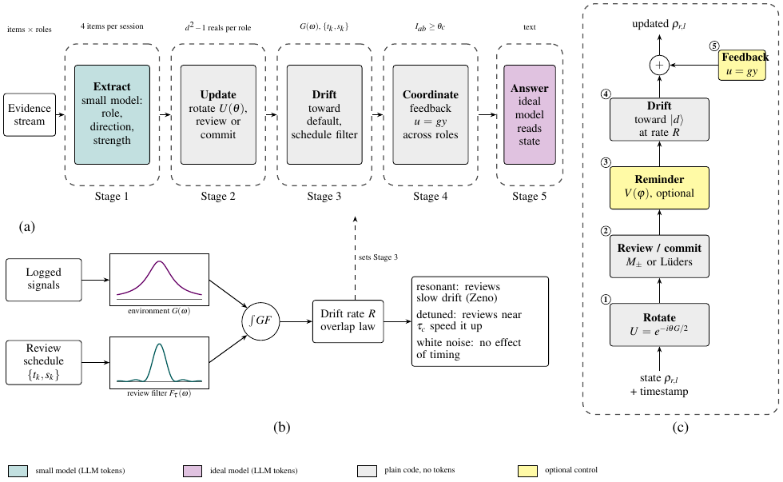
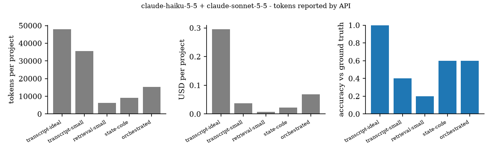
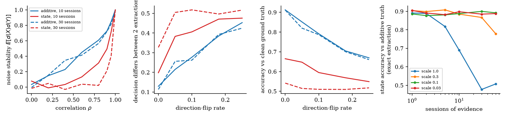
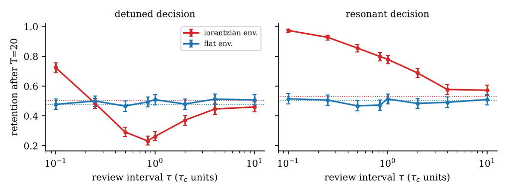
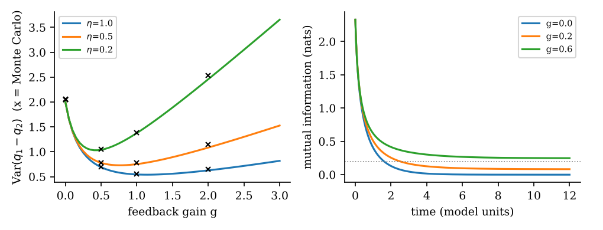

<div align="center">

# quorum-state

### A quantum-probability decision state for role-aware AI agents

Preprint, simulation package, tests, raw results and reports for
*Order, Timing, and Feedback: A Quantum-Probability Decision State for Role-Aware Agents*


</div>

<p align="center">
  
</p>
<p align="center"><em>The five-stage framework. Teal: small-model call. Violet: large-model call. Grey: plain code, no tokens.</em></p>

---

## Contents

1. [Overview](#1-overview)
2. [Key findings](#2-key-findings)
3. [Repository structure](#3-repository-structure)
4. [Quick start](#4-quick-start)
5. [Experiments](#5-experiments)
6. [Results](#6-results)
7. [Reproducibility and data provenance](#7-reproducibility-and-data-provenance)
8. [Claim status](#8-claim-status)
9. [Limitations and open items](#9-limitations-and-open-items)
10. [Roadmap](#10-roadmap)
11. [Running the API experiments safely](#11-running-the-api-experiments-safely)
12. [Correction log](#12-correction-log)
13. [Citation](#13-citation)
14. [Licence](#14-licence)

---

## 1. Overview

An AI agent that decides on behalf of several stakeholders (for example finance, engineering and operations)
usually keeps a long transcript and re-reads it for every decision. Cost grows with history, and the order and
timing of the evidence are left implicit.

This project replaces the transcript with a **decision state**: a small quantum-probability state (a qubit density
matrix) that is updated in plain code.

| Component | What it does |
|---|---|
| **Extract** | A small model reads each evidence item once and returns a role, a direction (+1 supports approval, −1 does not) and a strength in [0, 1]. |
| **Update** | Each item rotates the state about a role-specific axis. Roles use different, non-commuting axes, so the **order** of evidence changes the outcome, as order effects do in human judgement. P(approve) = Tr(Pρ) is read from the state. |
| **Drift and review** | The state relaxes toward a default ("do not approve"). Repeated reviews act as a spectral filter (an *overlap law*), giving **decision Zeno** and **anti-Zeno** regimes. |
| **Coordinate** | Proportional feedback across roles has an interior optimal gain. |
| **Answer** | A larger model reads only a one-line description of the state and writes the answer. |

Quantum probability is used purely as mathematics on ordinary computers. The project makes no claim that brains or
language models are quantum systems.

**The question under test** is not "is this more accurate than an LLM?". It is: *can this state keep a long decision
history cheaply, show human-like order effects, and be controlled through timing and feedback?* The honest answer so
far is mixed; see [Key findings](#2-key-findings).

## 2. Key findings

> **Read this before quoting any saving figure.** All costs use placeholder prices
> ($1 / $5 small model, $3 / $15 large model per million input / output tokens).

| # | Finding | Evidence |
|---|---|---|
| 1 | Against a **large model re-reading the whole transcript**, the framework's cost is **52–93% lower** in every real-API run. | e8, three runs |
| 2 | Most of that saving comes from **using a small model**, which on its own is 87–90% cheaper than the baseline. Against the small-model baseline the framework never reached a 50% saving. | e8 |
| 3 | **Accuracy was lower** for the state schemes in every real-API run (0.4–0.6 against 0.9–1.0). With 5–10 projects per run the intervals overlap, so this is not proven. | e7, e8 |
| 4 | **64–74% of the baseline's cost is output tokens** (266–468 per decision). The large model fed only the state wrote 61–82. At equal output length the orchestrated saving would be about 14%, 52% and 0% across the three runs. | e8 |
| 5 | The accuracy gap is mostly the **state's functional form**, not extraction noise: with perfect extraction the state reproduces an additive rule only 69% of the time at 10 sessions and 48% at 30. | e10 |
| 6 | Whether the state beats **order-blind memories on order-dependent tasks** is **untested**. `e11_accuracy_eval.py` was written for this and has not yet been run with the real API. | e11 |
| 7 | The theory (propositions, QQ equality, overlap law) is proved and tested; the Zeno, anti-Zeno and feedback results hold in simulation. They are **not yet tested in humans**. | tests, e0–e5 |

Full tables and the reasoning are in [`reports/EVALUATION.md`](reports/EVALUATION.md).

## 3. Repository structure

```
quorum-state/
├── README.md
├── paper/                       LaTeX source (main.tex, refs.bib, main.bbl), figures, compiled PDF
├── docs/                        framework figure and the figures used in this README
├── reports/
│   ├── EVALUATION.md            results evaluated against the 50%-saving goal
│   ├── RESULTS_e7.md            e7 real-API notes, including the failed 30-session run
│   └── CLAUDE_CODE_INSTRUCTIONS.md   instructions for running further experiments in Claude Code
└── qds_sim/                     Python package, experiments, tests and results
    ├── qds/                     core library: states, rotations, review, drift, feedback, order-effect models
    ├── experiments/             one script per study, e0 to e11, plus replot_e11.py
    ├── tests/                   4 test files, 24 checks
    ├── results/                 every output folder produced so far (CSV, JSON, PNG, logs)
    ├── RUN_E8.md, RUN_E9.md, RUN_E11.md   exact commands for the API experiments
    ├── CLAUDE.md                rules for Claude Code when it runs the benchmark
    └── run_all.py               tests plus every experiment (mock backends, no API cost)
```

## 4. Quick start

No API key and no cost.

```bash
git clone https://github.com/lalit-aditya/quorum-state.git
cd quorum-state/qds_sim
pip install -r requirements.txt          # Python 3.10+

python tests/test_core.py                # 13 checks: the paper's propositions and published numbers
python tests/test_pipeline.py            #  4 checks: step-by-step pipeline, noise operator
python tests/test_hierarchy.py           #  3 checks: macro / meso / micro hierarchy
python tests/test_e11.py                 #  4 checks: accuracy-evaluation script

python run_all.py --quick                # all experiments with mock backends (about 1.5 minutes)
```

Run a single experiment from `qds_sim/experiments/`, for example `python e1_zeno_schedule.py --seed 1`. Output goes to
`qds_sim/results/<name>/`.

## 5. Experiments

| Script | Question | Data |
|---|---|---|
| `e0_reanalysis.py` | Re-analysis of published order-effect data (paper Table 2) | **Real** (Wang & Busemeyer 2013) |
| `e1_zeno_schedule.py` | H1 decision Zeno; H2 anti-Zeno and the white-noise null | Synthetic |
| `e2_reminders.py` | H3 reminders versus recommitment | Synthetic |
| `e3_delay_qq.py` | H4 delay breaks the QQ equality; power | Synthetic |
| `e4_feedback.py` | H5 interior gain optimum; coordination death | Synthetic |
| `e5_model_recovery.py` | Can a study tell the models apart? | Synthetic |
| `e6_agent_memory.py` | Study-3 harness: transcript versus quantum memory | Synthetic, mock LLM |
| `e7_token_benchmark.py` | Tokens and accuracy of transcript, summary, retrieval and state memories | Real API or mock |
| `e8_orchestrated.py` | Small extractor plus large answerer versus traditional memories: tokens and dollars | Real API or mock |
| `e9_hierarchy.py` | Macro / meso / micro hierarchy with uncertainty-gated escalation | Real API or mock; **synthetic truth** |
| `e10_noise_stability.py` | Noise stability of the state (adapts Haris et al. 2026); fidelity to an additive rule | Simulation, no API |
| `e11_accuracy_eval.py` | Accuracy of every scheme with balanced truths, additive and **order-dependent** ground truths, paired tests, zero-token controls and output tokens per call | Real API or mock |

Synthetic is not evidence about people or LLMs. Experiments 1–6 generate data from the models themselves, so they
check that the analyses work and estimate effect and sample sizes. Only e0 uses real human data.

## 6. Results

### 6.1 Cost and accuracy with real API calls (e8)

Models: `claude-haiku-5-5` (small), `claude-sonnet-5-5` (large). Token counts are reported by the API. All runs had
0 parse errors, 0 truncated replies and 0 empty replies.

| Run | Accuracy: large-transcript / small-transcript / state / orchestrated | Saving vs large-transcript: state / orchestrated / small-transcript |
|---|---|---|
| 10 sessions, 10 projects, answer every session | 0.9 / 0.8 / 0.6 / 0.6 | 87% / 63% / 90% |
| 30 sessions, 5 projects, answer every session | 1.0 / 0.4 / 0.6 / 0.6 | 93% / 77% / 87% |
| 30 sessions, 5 projects, answer every 5th session | 1.0 / 0.4 / 0.4 / 0.4 | 67% / 52% / 87% |

<p align="center">
  
</p>
<p align="center"><em>30 sessions, 5 projects: tokens per project, cost per project (placeholder prices) and accuracy per scheme.</em></p>

### 6.2 Why the state loses accuracy (e10, no API)

<p align="center">
  
</p>
<p align="center"><em>Left to right: noise stability by correlation; decision disagreement between two noisy extractions; accuracy against the clean truth; agreement with the additive rule by rotation scale. Red: decision state. Blue: additive rule.</em></p>

At rotation scale 1.0 the state agrees with the additive rule 69% (10 sessions) and 48% (30 sessions) of the time even
with exact extraction. At scale 0.1 it agrees about 89–90%, but order effects then disappear, which removes the
framework's distinguishing property.

### 6.3 Timing: decision Zeno and anti-Zeno (e1, synthetic)

<p align="center">
  
</p>
<p align="center"><em>Retention after T = 20 against review interval. Detuned decisions are sped up by reviews near the environment's correlation time; resonant decisions are protected; a flat (white-noise) environment shows no schedule effect.</em></p>

### 6.4 Feedback: interior optimal gain (e4, synthetic)

<p align="center">
  
</p>
<p align="center"><em>Left: variance against feedback gain for observation efficiencies η = 1, 0.5, 0.2 (crosses: Monte Carlo). Right: feedback keeps coordination from collapsing.</em></p>

### 6.5 Other results

* **e0 (real data):** the QQ-constrained model has the best AIC in 4 of 6 published data sets; one-dimensional ("rank-one") models are rejected in all.
* **e5:** symmetric classical anchoring satisfies the QQ equality exactly, so the equality alone cannot separate quantum from classical accounts.
* **e7 (real API):** at 10 sessions the state used 0.62× the transcript's tokens with accuracy 0.60 against 0.80 (10 projects, intervals overlap). The 30-session run timed out and produced no results.
* **e9:** only a 66-call, 3-project pilot with a synthetic ground truth exists; no claim about the hierarchy is supported yet.

## 7. Reproducibility and data provenance

| Folder in `qds_sim/results/` | Kind | Status |
|---|---|---|
| `e0_reanalysis` to `e6_agent_memory` | Re-analysis and simulations | Complete |
| `e7_mock`, `e8_orchestrated`, `e9_hierarchy` | Mock backend, estimated tokens | Pipeline checks only |
| `e7_pilot`, `e8_pilot`, `e9_pilot` | Real API pilots (18, 75 and 66 calls) | Valid, no statistical power |
| `e7_s10` | Real API, 10 projects × 10 sessions (600 calls) | Valid |
| `e7_s30.log` | Real API, 30 sessions | **Failed** (API timeout), no results |
| `e7_ckpt_test`, `e7_ckpt_crash` | Checkpoint and resume tests | Test artefacts |
| `e8_s10`, `e8_s30`, `e8_s30_d5` | Real API (500, 750 and 270 calls) | Valid |
| `e10_noise_stability` | Simulation, no API | Complete; reproduced independently |
| `e11_accuracy_eval` | none | **Not yet run with the real API** |

* All simulations use fixed seeds. A rerun of e10 on a second machine matched the paper's Table 5 exactly.
* A real-API run is valid only with 0 parse errors, 0 truncated and 0 empty replies; `summary.json` records this.
* Prices in `summary.json` are flagged when they are the placeholder defaults.

## 8. Claim status

| Claim | Status |
|---|---|
| Order effects arise from non-commuting role rotations; the QQ equality holds in the model; symmetric classical carry-over also satisfies it | **Proved and tested** |
| The review schedule acts as a spectral filter (Zeno and anti-Zeno); white-noise null | Supported in simulation |
| An interior optimal feedback gain exists in the surrogate | Supported in simulation |
| State memory uses fewer tokens than re-reading a transcript | Supported in templated benchmarks; retrieval is cheaper still |
| The framework saves more than 50% **against a small-model or summary baseline** | **Not supported** by current data |
| The state is as accurate as transcript memory | **Not supported**; point estimates lower, n small |
| The state beats order-blind memory when evidence order matters | **Untested** (e11) |
| Macro / meso / micro hierarchy | **Untested** beyond a pilot |
| H1–H5 in humans | **Untested**; no human studies yet |

## 9. Limitations and open items

* The benchmarks use templated evidence, an additive ground truth, one model pair, 5 to 30 projects and placeholder prices.
* The additive ground truth favours additive memories; an order-dependent truth is the fair test (e11).
* The hierarchy's ground truth and meso plan rule are synthetic stand-ins.
* A cached-prefix (prompt caching) baseline is not implemented. A rolling-summary baseline exists in e7 and in e11 (`--with-summary`).
* Larger runs (50+ projects, balanced truths, the ideal-model thinking setting recorded) are not done.
* References [28]–[30] in the paper are marked "to be verified" and need checking against their sources.
* The acknowledgements are generic; add a supervisor, institution or funding if applicable.
* Several system papers the work draws on are recent preprints that have not been peer reviewed.

## 10. Roadmap

1. Run `e11_accuracy_eval.py` with 60 or more projects (see [`qds_sim/RUN_E11.md`](qds_sim/RUN_E11.md)) and report whether the state beats the order-blind control.
2. Add a cached-prefix baseline and compare cost against the strongest cheap alternative.
3. Equalise output caps and record the thinking setting for every scheme.
4. Replace placeholder prices and the synthetic hierarchy rule with real ones.
5. Human studies for H1–H5 (pre-registered protocols are in the paper).

## 11. Running the API experiments safely

* Set the key in the environment only, never in a file, a log or a chat:
  `export ANTHROPIC_API_KEY=...` (PowerShell: `$env:ANTHROPIC_API_KEY="..."`).
* Every API script prints the planned number of calls and asks before spending; `--max-calls` is a hard cap.
* Set your real prices with `--price-small IN,OUT --price-ideal IN,OUT`.
* Do not change prompts, ground truth or `--state-scale` after seeing results. Use fresh `--seed` values for confirmation runs and report any post-hoc tuning as exploratory.

## 12. Correction log

* **Agent-memory role axes.** An earlier version used the x, y and z axes, so engineering and operations evidence initially had no effect on P(approve). All role axes now have a y-component.
* **Paper Table 2.** The rank-one column listed the reverse-order cells in the wrong order in an earlier script; fixed.
* **e7–e9 comments.** A comment claimed the state "matches the ground truth". It does not (see e10). The gap in the API runs is mostly the state's functional form, not extraction noise.
* **Paper Section 7.4.** g\* corrected to 1.14 / 0.76 / 0.43 and the coordination-death time to 1.61.
* **e10 noise operator.** It now uses keep probability ρ, so ρ is the item correlation; documented in the paper.
* **Earlier attribution of the accuracy gap.** An earlier statement that the gap was mainly extraction noise was wrong; e10 showed the functional form is the larger limit.

## 13. Citation

```bibtex
@misc{aditya2026quorumstate,
  author       = {Lalit Aditya R D},
  title        = {Order, Timing, and Feedback: A Quantum-Probability Decision State for Role-Aware Agents},
  year         = {2026},
  note         = {Preprint},
  howpublished = {\url{https://github.com/lalit-aditya/quorum-state}}
}
```

Related work this repository builds on: Haris, Zhang and Yoshida (ICLR 2026, arXiv:2602.08287) for the noise-stability
analysis; Kofman and Kurizki (2005) for the overlap law; Wang and Busemeyer (2013) for the real order-effect data.

## 14. Licence

No licence has been chosen yet. Add a `LICENSE` file (code) and a `LICENSE-paper` file (text and figures) before
making the repository public.
